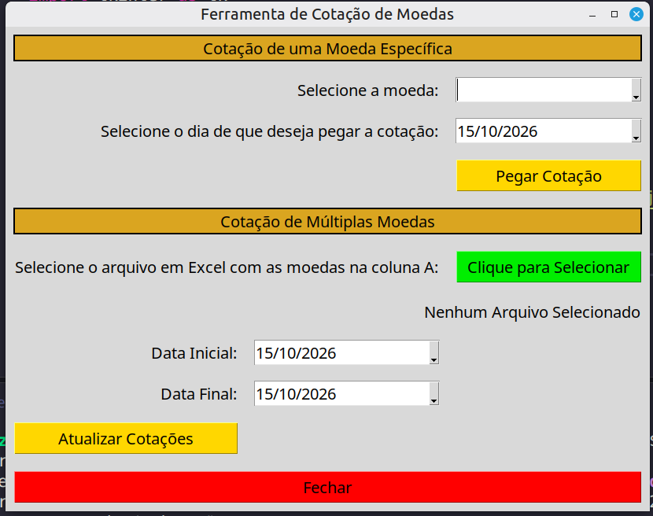
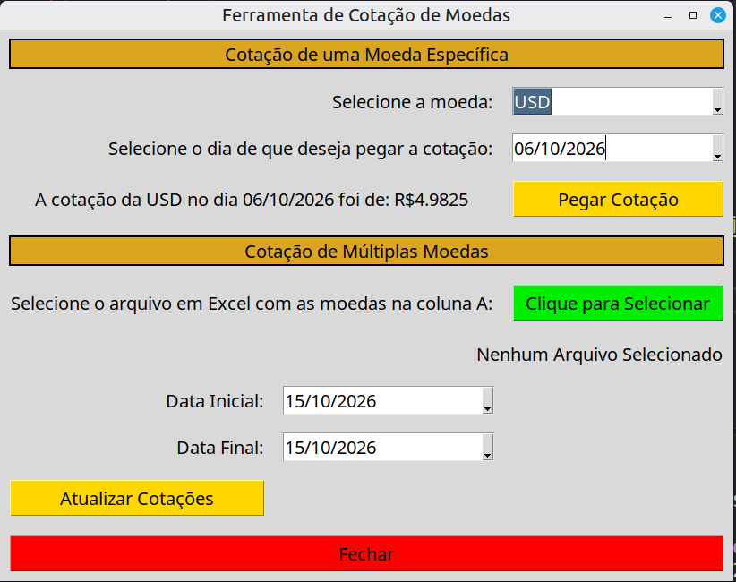
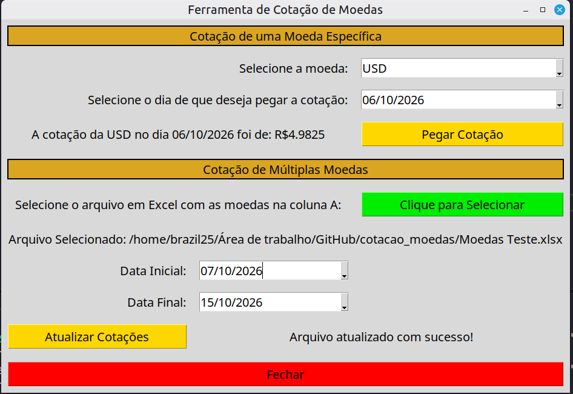

# Programa de Cotação de Moedas

Programa que busca e informa a cotação de moedas utilizando a API da plataforma AwesomeAPI.

---

## Demonstração

| Janela Inicial | Cotação de Uma Moeda |
| :---: | :---: |
|  |  |

| Cotação de Várias Moedas |
| :---: |
|  |

---

## Tecnologias

Este projeto foi desenvolvido utilizando as seguintes tecnologias:

- **Python 3.12.3**
- **Tkinter (Criação de janela para o programa)**
- **Requests (Requisições para a API de cotações de moedas)**
- **Pandas (Leitura e criação de tabelas)**
- **Datetime (Manipulação de datas)**

---

## Funcionalidades

- [x] Cotação de uma moeda listada no programa, em qualquer data disponível
- [x] Cotação de um grupo de moedas listadas em um arquivo do Excel
- [x] Criação de um arquivo do Excel com as cotações solicitadas

---

## Estrutura de Dados

O projeto conta com um arquivo `Moedas Teste.xlsx` contendo exemplos de moedas para permitir o teste do programa. Após realizar a cotação de múltiplas moedas utilizando esse arquivo em Excel, ou qualquer outro que esteja organizado da mesma maneira, o programa criará um arquivo em Excel de cotações e salvará na pasta raiz do projeto.

---

## Como Executar o Projeto

### Pré-requisitos

Antes de começar, você precisará ter instalado em sua máquina:
- [Git](https://git-scm.com)
- [Python 3.12](https://www.python.org/)

### Passo a Passo

1. **Clone este repositório:**
   ```bash
   git clone https://github.com/Brazil25/cotacao_moedas
   ```

2. **Acesse a pasta do projeto:**
   ```bash
   cd cotacao_moedas
   ```

3. **Crie e ative o ambiente virtual (opcional, mas recomendado):**
   ```bash
   python -m venv .venv
   source venv/bin/activate  # Linux/Mac
   # ou: venv\Scripts\activate  # Windows
   ```

4. **Instale as dependências:**
   ```bash
   pip install -r requirements.txt
   ```


5. **Execute a aplicação:**
   ```bash
   python main.py
   ```

---

## Licença

Este projeto está sob a licença MIT.
